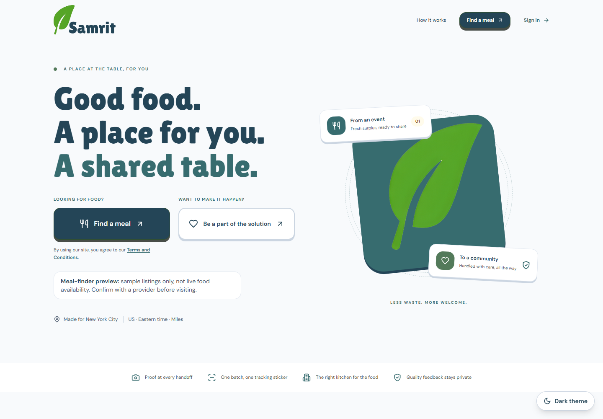

# Samrit

**A place at the table. A community behind it.**

**Built at SBUHacks 2026 · Stony Brook University**

Samrit is a food-rescue coordination and accessibility platform connecting people seeking meals, event organizers with surplus food, distribution centers, and a central NGO managing pickups and deliveries. Designed around New York City, it brings meal discovery, donor workflows, dispatch, and accountability into one system.

Our guiding idea: **make food easier to access while making distribution easier to coordinate and track.**



## Highlights

- **Discover meals without an account:** explore demo meal offers, filter allergens, describe dietary preferences in everyday language, and browse NYC assistance locations on a map.
- **Rescue event surplus:** create donor events, use Gemini to extract food information from menus or invoices, confirm dishes, and record leftover servings for pickup.
- **Coordinate NGO logistics:** approve receiving centers, manage drivers and vehicles, check equipment and handling compatibility, and assign deliveries.
- **Document the chain of custody:** use event and venue QR scans, unique container stickers, pickup and intake photographs, and ordered handoff records.
- **Collect private feedback:** visitors check in with a shared venue QR, finish their visit in the app, and send feedback for NGO review.
- **Apply AI with safeguards:** Gemini assists with meal matching, document extraction and review analysis; the backend validates its outputs while staff retain responsibility for operational decisions.
- **Offer accessible interactions:** combine responsive layouts, light/dark themes, keyboard-friendly controls and voice assistance using ElevenLabs for speech and Gemini for intent interpretation.

## How it works

1. A donor records an event, confirms the menu and marks the remaining servings.
2. The NGO reviews the food batch and assigns a suitable driver, vehicle and approved receiving center.
3. QR scans, container identification and photos document the pickup and delivery handoffs.
4. People looking for food can search available demo offers and assistance listings, with voice and preference-based discovery.

## Documentation

| Reader | Documentation |
| --- | --- |
| Judges and first-time readers | [Platform overview and documentation index](docs/README.md), [submission and demo guide](docs/SUBMISSION_GUIDE.md) |
| Food seekers, donors, centers, drivers and NGO admins | [Complete user manual](docs/USER_MANUAL.md) / [print-ready PDF](docs/USER_MANUAL.pdf) |
| Product reviewers | [Development improvements and business decisions](docs/DECISIONS_AND_IMPROVEMENTS.md) |
| Developers | [Architecture and data model](docs/ARCHITECTURE.md), [API contract](API_CONTRACT.md) |
| Deployers and operators | [Operations, deployment and recovery](docs/OPERATIONS.md) |
| Product owners | [Known limitations and prioritized roadmap](docs/ROADMAP.md) |
| Testers | [Automated complete-flow test](docs/COMPLETE_FLOW_TEST.md) |

## Technology

| Layer | Implementation |
| --- | --- |
| Web application | React, TypeScript, Vite, Tailwind CSS, React Router |
| API | NestJS with the Express adapter, JWT authentication, role checks and Zod contracts |
| Data | PostgreSQL 15+, relational schemas, foreign keys, constraints and versioned migrations |
| Cache / infrastructure | Redis 7, Docker Compose for local services |
| AI | Server-side Gemini gateway for meal filtering, document extraction, review analysis and voice intent interpretation |
| Speech | ElevenLabs speech transcription and synthesis |
| Maps and scanning | Leaflet/OpenStreetMap, browser geolocation, camera QR scanning and generated QR codes |
| Validation | Jest, Vitest, Playwright-based browser/API walkthroughs and isolated database checks |

The frontend and backend use JavaScript/TypeScript; exact dependencies are pinned in their lockfiles.

## Run locally

Requirements: Node.js **22.12+**, npm **10+**, PostgreSQL **15+**, and Redis **7**. Docker with Compose v2 can provide the two infrastructure services.

```sh
git clone https://github.com/arjunrokad7/Samrit.git
cd Samrit
npm run setup
npm run infra:up
npm run doctor -- --services
npm run db:migrate
npm run db:seed
npm run dev
```

`setup` installs locked frontend/backend dependencies and creates private environment files, preserving existing configuration. Fresh setup generates local JWT/admin secrets. If you already have PostgreSQL/Redis, skip `infra:up` and configure `backend/.env` for those services. The configured database must exist; Compose creates its database on first volume initialization.

In a second terminal, after the backend is running:

```sh
npm run seed:demo
node scripts/seed-fleet.cjs
node scripts/seed-accounts.cjs
```

- Website: **http://localhost:5173**
- Public meal finder: **http://localhost:5173/consumer**
- Visitor check-in: **http://localhost:5173/consumer/check-in**
- Sign-in: **http://localhost:5173/login**
- API documentation: **http://localhost:3000/api**
- Health endpoint: **http://localhost:3000/health**

The demo seed creates or reuses local example data without resetting existing routes. Optional `node scripts/seed-fleet.cjs --with-route` creates an example route when its chosen driver and truck are available.

### Demo accounts

The following accounts are created by the local demo seed commands **for development and testing only**. Do not use them in a public deployment.

| Category | Email | Password |
| --- | --- | --- |
| Donor / event venue | `donor@example.com` | `Demo123!` |
| Distribution center | `ngo@example.com` | `Demo123!` |
| NGO driver | `driver.maya@example.com` | `DemoDriver123!` |
| Second NGO driver | `driver.jordan@example.com` | `DemoDriver123!` |
| Demo central admin | `admin.demo@example.com` | `DemoAdmin123!` |

The bootstrap administrator uses `SUPER_ADMIN_EMAIL` and `SUPER_ADMIN_PASSWORD` from the private backend environment. Fresh setup generates that password; it is not the demo admin password. Drivers are provisioned by the NGO and cannot register publicly. People finding food do not need an account.

## Configuration

| Settings | Purpose |
| --- | --- |
| `DATABASE_HOST`, `DATABASE_PORT`, `POSTGRES_USER`, `POSTGRES_PASSWORD`, `POSTGRES_DB` | PostgreSQL connection |
| `REDIS_HOST`, `REDIS_PORT` or `REDIS_URL` | Redis connection |
| `JWT_SECRET`, `SUPER_ADMIN_EMAIL`, `SUPER_ADMIN_PASSWORD` | Authentication and initial administrator |
| `GEMINI_API_KEY`, `GEMINI_MODEL` | Optional server-only Gemini access; use a model available to your account |
| `UPLOAD_DIR`, `PRIVATE_DOCUMENT_DIR` | Custody-image and private document storage |
| `APP_CITY`, `APP_TIMEZONE`, `APP_LOCALE` | NYC / `America/New_York` / `en-US` defaults |
| `QR_MAX_DISTANCE_METERS` | Custody proximity threshold; default 250 m |
| `VITE_API_URL` | Public frontend API address; never store a provider secret in `VITE_*` settings |

Manual menus and the delivery workflow remain available without Gemini. Smart filtering reports an unavailable provider; review intake falls back to human review. Server environment changes require a backend restart. Full configuration and deployment guidance is in [Operations](docs/OPERATIONS.md).

## Test and build

```sh
npm run build
npm test
npm run test:database
npm run test:api
npm run test:ui:smoke
npm run test:complete
npm run test:complete -- --with-ai
```

Build/unit checks do not require a browser. Integration and browser checks need the running local services; browser checks use Chrome locally or a configured `CHROME_PATH`. The complete-flow test creates isolated fixtures, exercises the public UI and real role APIs, then cleans up. `--with-ai` requires real Gemini results for extraction, preference filtering and review analysis; provider failures fail those strict assertions.

Results, screenshots and generated test QR images go into ignored output folders. Automated QR fixtures are removed after the run and should not be used for a later manual demo. Generate a persistent local manual pack with:

```sh
node scripts/create-demo-test-pack.cjs
```

This creates a test event, QR images, sample menu/invoice PDFs, example handoff photos and walkthrough instructions under `releases/demo-test-pack/`.

## Demo data and responsible use

- The assistance directory includes **59 listings** imported with provenance from [NYC Open Data](https://data.cityofnewyork.us/City-Government/Facilities-Database/ji82-xba5). These public directory entries are not verified Samrit partners or confirmations of current meal availability.
- The meal finder currently demonstrates preference search with **three sample meal offers**. Connecting completed rescue deliveries to automatically published public offers is a planned integration.
- The local demo uses example drivers, vehicles, routes and handoff evidence. Food-safety decisions remain with responsible people and organizations; QR records, photographs and hashes support traceability rather than certify safety.
- GPS and route information are intended for coordination, not independent proof of presence or live vehicle navigation. Visit duration reflects check-in through the visitor's Finish action.

See the [Roadmap](docs/ROADMAP.md) for current integration priorities and steps toward real-world deployment, including partner onboarding, accessibility, security and food-handling review.

## Team and collaboration

Developed collaboratively for **SBUHacks 2026**, hosted by the Computer Science Society at Stony Brook University. See the [team workflow](docs/TEAM_WORKFLOW.md) for collaboration guidance.

## Share and collaborate

`npm run share` creates a source-only archive at `releases/samrit-team.zip`. It includes manifests, lockfiles, migrations, public seed data and documentation; it excludes dependencies, local runtimes, credentials, databases, backups and uploads. Read [Team workflow](docs/TEAM_WORKFLOW.md) before parallel development. The repository is [arjunrokad7/Samrit](https://github.com/arjunrokad7/Samrit).

## License and attribution

Samrit is distributed under the [MIT License](LICENSE). The project builds on the Food Redistribution Platform foundation; original notices are retained in [THIRD_PARTY_NOTICES.md](THIRD_PARTY_NOTICES.md). OpenStreetMap attribution remains visible on maps. Public-source provenance is retained with imported records. Gemini and public data sources do not imply endorsement or partnership.
