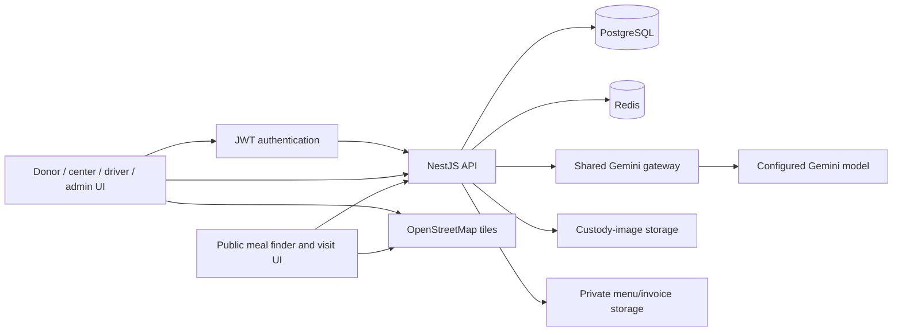
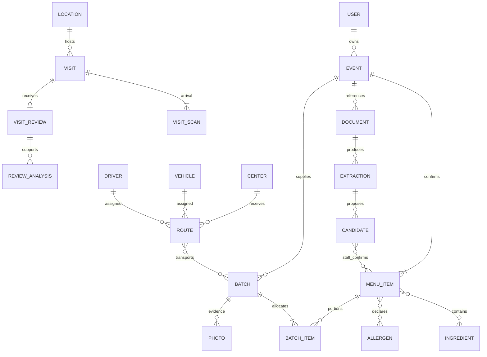
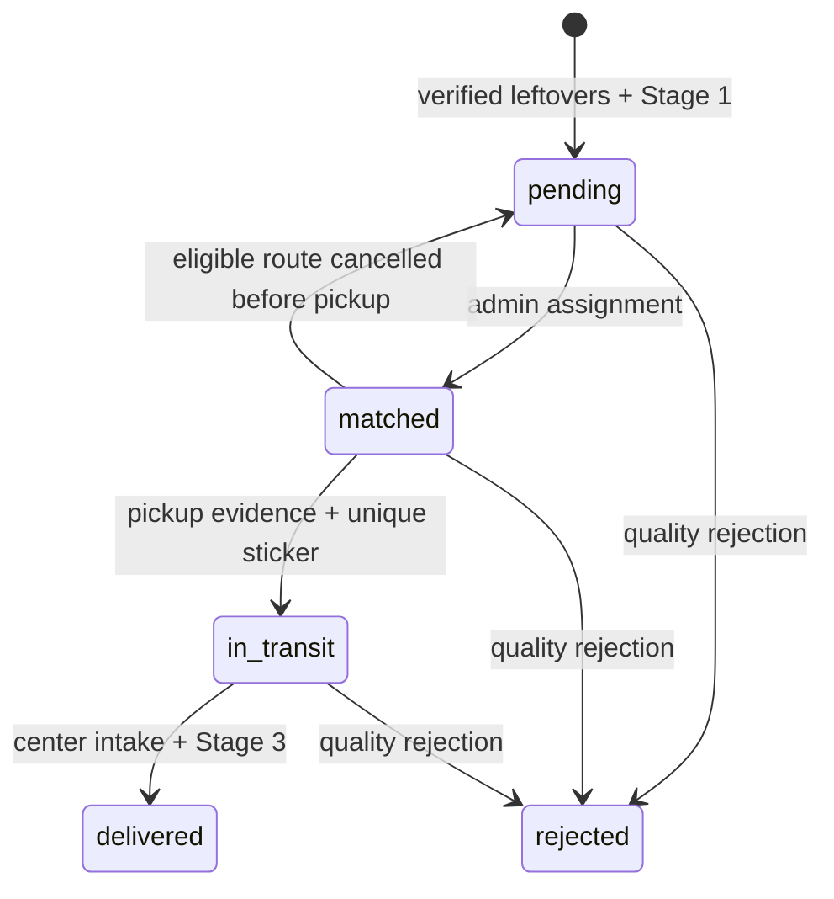

# Platform architecture and data model

## 1. Scope

Samrit is a TypeScript monorepo with a React/Vite web application, a NestJS API, PostgreSQL and Redis. It retains compatible inherited modules while implementing the current product under `frontend/src/samrit` and `backend/src/samrit`. The folder name shown by an old IDE tab does not select the running project; use the canonical `Samrit` repository.



The browser does not receive Gemini credentials or construct the authoritative candidate set for AI search. Provider requests originate on the server. Real directory imports run as explicit scripts and retain provenance.

## 2. Repository map

| Path | Responsibility |
| --- | --- |
| `frontend/src/samrit/` | Active product screens, shared UI recipes, theme, maps and scan/photo components |
| `frontend/src/App.tsx` | Public/workspace routes and global providers |
| `frontend/tailwind.config.js`, `src/design-entry.css` | Brand utilities, semantic color variables and theme surfaces |
| `backend/src/samrit/` | Domain controller/service, evidence/visit flows, consumer search and Gemini gateway |
| `backend/src/database/relational-store.ts` | Typed relational writes and compatible API reads |
| `backend/src/auth/` | Accounts, JWT validation and profile restrictions |
| `shared/types/` | Shared domain and consumer-meal types |
| `database/bootstrap.sql` | Initial inherited account/module schema, compatible with PostgreSQL 15 |
| `database/migrations/` | Ordered, checksummed domain migrations |
| `database/seeds/` | Public NYC snapshot; no private production database dump |
| `scripts/db/` | Migrate, backfill, seed/import, snapshot, restore and isolated checks |
| `scripts/` | Local setup, packaging, demo seeding and test runners |
| `docs/` | Manuals, decisions, operational reference and original references |

Inherited `pages/`, donation, notifications and other modules remain for compatibility; their existence does not make all of their old screens part of the current active Samrit experience.

## 3. Identity and access

The existing `public."user"` table remains the account authority, retaining UUIDs and password hashes. The `identity.users` view exposes a limited account projection; organization membership and driver profiles are normalized separately.

| Internal role | Active product meaning | Public registration |
| --- | --- | --- |
| `DONOR` | Donor/event venue | Allowed |
| `NGO` | Receiving distribution center | Allowed; center approval is separate |
| `VOLUNTEER` | NGO-managed driver | Rejected; admin provisions |
| `ADMIN` | Central NGO operator | Rejected; bootstrap/configured administrative creation |

Public consumer routes do not require an account. Visitor access instead uses an opaque visit identifier and secret. Finishing or reviewing a visit requires its credentials. The secret is held in memory by the current browser page and stored only as a hash on the server.

Authenticated workflows check account activity and role. Domain service rules additionally enforce ownership and assignment: an arbitrary donor cannot modify another donor's event, a free driver cannot pick up an unrelated batch, and only the receiving center can provide the final intake proof. Role checks alone are not treated as sufficient authorization.

The current architecture assumes one central coordinating NGO. Membership tables are not a claim that complete multi-tenant query isolation exists.

## 4. Relational schemas

| Schema | Records and purpose |
| --- | --- |
| `identity` | Organizations, memberships and NGO driver profiles |
| `directory` | Providers, locations, service categories, hours/exceptions and registered partner centers |
| `food` | Events, verified menu items, ingredients, allergens, portion allocations, batches, meal offers, documents/extractions/candidates/confirmation links |
| `logistics` | Vehicles, equipment, handling capabilities, routes, stops and route-to-batch links |
| `evidence` | Photos, custody events and location reports |
| `feedback` | Venue QR lookup, visits, arrival scans, reviews and review-analysis records |
| `app` | Domain ID registry, JSON API projections and AI job ledger |
| `audit` | Changes, public sources, import runs, source records and dated statistics |



Composite primary keys protect join-table uniqueness. Domain UUIDs are preserved across migration. Foreign keys connect ownership and lifecycle records. Constraints check allowed states, nonnegative/positive quantities, coordinate ranges, required evidence, approved core classifications and valid metadata. Deferred constraints support a transaction that attaches a newly created photo to its batch without weakening the final relationship.

Indexes cover kind/time projections, ownership, batch expiry, center/driver status, coordinates, route relationships and evidence chronology. Latitude/longitude are regular bounded columns; the implemented code does not require PostGIS, even if the development Compose image includes it.

### Miscellaneous fields

Appropriate tables have object-valued `metadata` JSONB fields capped at 16 KB. They hold additional context such as packaging notes or source precision. Core columns remain the authority. Frontend food notes are an example editor; not every metadata-capable table has a generic UI editor.

## 5. Migration and compatibility strategy

The migration runner initializes a new account schema if needed, obtains an advisory lock, validates SHA-256 checksums, and applies pending SQL in transactions. Runtime TypeORM `synchronize` is disabled. Changing an applied migration is an error; add a new migration instead.

The original generic `samrit_record` table remains unchanged as a recovery reference. A transactional backfill writes its existing domain records into normalized tables in dependency order. The domain ID registry tracks identity/kind/time, not a second full payload. SQL projections reassemble the API shape expected by the frontend.

Migrations cover the relational core, API projections, integrity/index additions and the single-venue-QR transition. The last preserves old exit scans while new visits use `finished_at` and `completion_method='button'`. Historical routes lacking vehicle references remain representable.

The bootstrap contains column-level `NOT NULL` declarations. Redundant PostgreSQL-18-style named not-null statements were removed so that a clean PostgreSQL 15 CI database can initialize successfully.

## 6. Batch and route lifecycle



The diagram is a state overview, not permission to bypass the scan/photo gates within each transition. Driver arrival is an evidence event; it does not itself mean delivered. A receiving-center account supplies final evidence.

Portion allocation links batches to confirmed event menu items. The application and database reject cross-event portions and cumulative leftover counts exceeding the recorded event servings. A batch cannot silently replace menu ingredients or allergens. A deadline must be in the future and eligible matching must remain feasible before it.

Dispatch and custody changes run within a transaction-wide advisory lock. Partial unique indexes enforce one active route per driver and per non-null vehicle. This protects overlapping requests across API processes, not just a single JavaScript event loop.

Cancellation is supported only before pickup evidence/collection. It releases reservations and returns eligible batches to pending. Rejection is a separate recorded quality action; completed deliveries are not reversed through a casual rejection request.

## 7. Matching and mapping

Matching is a deterministic service, not a Gemini route planner. The admin selects a driver and vehicle. The backend filters centers by approval, equipment, capacity and hours at current/projected arrival, then evaluates expiry and travel feasibility.

Geographic distance is computed with a Haversine-style miles calculation. Travel time uses planning assumptions, including an approximate 12 mph and a handling allowance. Current center scoring also incorporates negative handoff-feedback counts. This influence should be reviewed for fairness, recency and evidence strength before an operational pilot; it is distinct from visitor-review AI analysis.

Route waypoints and connections are displayed on a street map as straight lines. They are not road-access instructions or truck-specific directions. Driver location reports and custody scans update recorded positions with a source/time. There is no continuous telemetry feed.

Public maps show fictional meal markers or sourced directory markers in separate contexts. Real providers with unknown meal/ingredient details are not treated as supported preference matches.

## 8. Gemini tasks and trust boundaries

| Task | Data supplied | Output gate | Failure behavior |
| --- | --- | --- | --- |
| Meal filter | Note plus eligible server catalog metadata | Valid decision per exact meal ID; no duplicates or invented IDs | Report note not applied; retain deterministic allergen exclusions |
| Menu OCR | Validated private image/PDF | Bounded candidate schema; unknown data remains unresolved | Retain source/failed extraction; allow manual entry |
| Invoice OCR | Invoice document with distinct prompt | Same candidate boundary; purchases are not confirmed prepared food | Same manual-entry option |
| Handoff review | Private text and custody context | Flags, summary, consistency and uncertainties | Manual review |
| Visit review | Private text, arrival evidence and completion context | Same analysis schema; no truth score | Manual review |

One gateway selects the configured model and uses only the server's Gemini key. It limits concurrent calls, sets timeouts and validates model JSON with Zod. Documents and user text are treated as untrusted content rather than instructions that can change application policy. Schema validation reduces risk but does not prove that the model's statements are factually correct.

The job ledger stores task, model, prompt version, actor/related record where applicable, input hash, status, result and sanitized error code. It does not log raw prompts or document bytes. Public search notes are not persisted as raw job inputs. AI results and private reviews still need a retention/access policy.

The old key-alias/rotation and alternate Qwen ideas are not active supported configuration. Do not place provider credentials in `VITE_*` variables, which are public build inputs.

## 9. Single-QR visit model

The same venue string supports two independent operations:

```mermaid
sequenceDiagram
  participant Driver
  participant Visitor
  participant API
  participant DB
  Driver->>API: Assigned batch + venue QR + GPS
  API->>DB: Authorized custody arrival
  Visitor->>API: Venue QR + optional arrival GPS
  API->>DB: Visit + arrival scan + secret hash
  API-->>Visitor: Opaque visit credentials
  Visitor->>API: Finish using visit credentials
  API->>DB: Server finished_at; method=button
  Visitor->>API: Sentiment and private feedback
  API->>DB: One review for completed visit
```

There is no new exit scan. The completion endpoint is idempotent with respect to the first stored completion time. Review creation locks the visit and rejects duplicates. Old paired-QR data remains historical evidence. No model should infer an exit location when none exists.

Per-IP request windows and shared-gateway concurrency limits bound usage within the current server process. They are not a distributed abuse-control system; a horizontally scaled deployment must move that state to shared infrastructure and define proxy handling explicitly.

## 10. Storage and privacy boundaries

- Menu/invoice originals are stored outside the public upload directory. Authenticated download permits the uploader or central admin, uses attachment delivery, disables caching and sets `nosniff`.
- Custody images use the inherited `/media/` static serving path. UI/API authorization restricts who sees references, but possession of a media URL is not an authenticated object-storage boundary. Production requires access-controlled media delivery.
- Stored photo hashes identify bytes retained by the server. They do not establish physical origin, capture time or food safety.
- Anonymous visit secrets are held in browser memory, protecting simple unauthorized finish/review requests but losing resumability on reload.
- Provider requests leave the application boundary. Retention, jurisdiction, consent and provider terms need an operator decision before public use.

## 11. Validation and CI

The test suite separates unit/UI contracts, isolated schema checks, authenticated API custody tests, browser smoke checks and a complete hybrid walkthrough. Strict live-AI mode exercises real provider behavior instead of substituting a canned success. All fixture runs need the appropriate local services and clean only their own records.

GitHub CI checks backend types/lint/tests/schema/E2E/build and frontend types/tests/build. The optional inherited frontend E2E suite does not fully represent the current product and is not accepted as the sole evidence for it. CodeQL scans the full JavaScript/TypeScript repository once and retains SARIF when GitHub Security-tab upload is unavailable.

These checks establish the exercised behavior, not exhaustive security, accessibility, load, mobile hardware or food-safety validation. Refer to [Operations](OPERATIONS.md) for deployment controls and [Roadmap](ROADMAP.md) for known work before launch.
