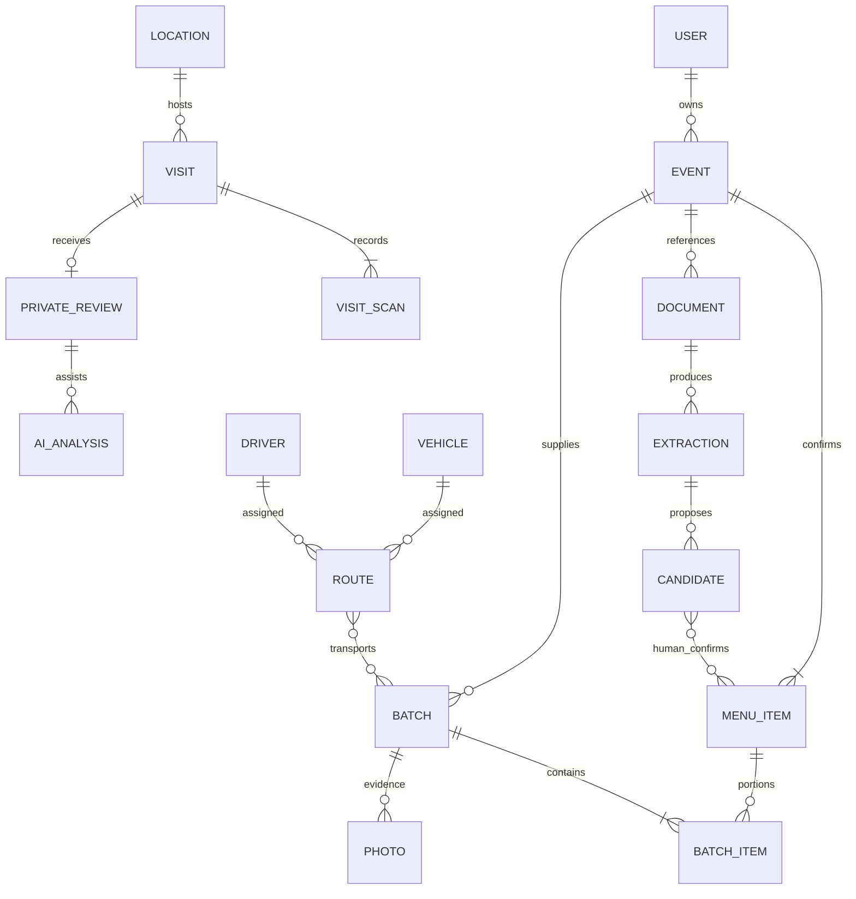

# Samrit database and evidence workflows

Samrit uses PostgreSQL as the authoritative store. Runtime TypeORM schema synchronization is disabled. Existing account UUIDs, password hashes, custody evidence and route IDs are preserved. The old `public.samrit_record` table remains an unchanged recovery reference; application reads and writes use the normalized tables and SQL projections.

## Getting a teammate running

From the repository root, with Node 22.12+ and PostgreSQL/Redis available:

```powershell
npm run setup
npm run infra:up
npm run db:migrate
npm run db:seed
npm run dev
```

Then run `npm run seed:demo` and `node scripts/seed-fleet.cjs --with-route` against localhost to create fictional operational accounts, custody examples, three vehicles and NGO-provisioned drivers. The configured central admin credentials come from the teammate's private environment. Demo login details are documented in the existing demo setup files; they are not production credentials. `db:seed` loads the public directory snapshot, three fictional consumer meals and historical reference statistics. It does not create real-provider accounts or available trucks from public statistics.

Backend start commands apply pending migrations before accepting requests. Migrations use a PostgreSQL advisory lock, transactions and SHA-256 checksums. Editing an applied SQL migration is rejected; add a new numbered migration. A clean database initializes the legacy account tables from `database/bootstrap.sql`, then applies the new schema. Existing installations receive an additive migration and a transactional legacy backfill.

Required backend settings remain `DATABASE_HOST`, `DATABASE_PORT`, `POSTGRES_USER`, `POSTGRES_PASSWORD`, `POSTGRES_DB`, Redis settings, `JWT_SECRET`, and central admin settings. Gemini uses only `GEMINI_API_KEY` and `GEMINI_MODEL` on the server. Keep the working model configured for your Google account. `PRIVATE_DOCUMENT_DIR=private_documents` stores originals outside the public custody-photo directory. Use durable private storage when deploying; local ephemeral disks will lose uploaded originals. All dates are stored with time zones and displayed in `America/New_York`.

## Schema ownership

| Schema | Main records |
| --- | --- |
| `identity` | Organizations, memberships, NGO-managed driver profiles; a safe users view over the existing account table |
| `directory` | Public providers, geocoded locations, services, hours/exceptions, approved partner centers |
| `food` | Donor events, confirmed menu items, ingredients/allergens, leftover batches/items, meal offers, source documents and extraction candidates |
| `logistics` | Vehicles, equipment, capabilities, routes, ordered stops and batch assignments |
| `evidence` | Custody photos, scans and timestamped driver-location reports |
| `feedback` | Shared venue QR lookup, anonymous visits, arrival scans, completion times, private reviews and separate AI analyses |
| `app` | Domain ID registry, API projections and validated AI job results |
| `audit` | Source records, import runs, dated organizational statistics and change events |

UUID primary keys and foreign keys connect domain records. Child join tables have composite keys. Constraints validate status, temperatures/handling, GPS ranges, nonnegative quantities, required delivery evidence, same-event batch items, cumulative leftover portions, same-venue historical scan relationships and visit-completion fields, and one active route per driver/vehicle. Indexed ownership, status, expiry, coordinates and evidence-time fields support current workflows. Coordinates use PostgreSQL latitude/longitude columns; PostGIS is not required by these migrations.



`metadata` is the miscellaneous JSONB field on food items, events, batches, vehicles, organizations, providers and other extensible records. It must be an object of at most 16 KB. Core ownership, allergen, quantity, location and status fields remain typed columns and cannot be replaced by metadata. Venue staff can add miscellaneous food notes in event planning.

## Public and fictional data

The checked-in snapshot contains **59 accepted public listings across all five boroughs**, imported from the [NYC DCP Facilities Database](https://data.cityofnewyork.us/City-Government/Facilities-Database/ji82-xba5). The importer selects explicit soup-kitchen/food-pantry categories, validates coordinates, and skips duplicate/invalid rows. Each listing links to its raw source record, retrieval time, source URL, content hash and import run. Refresh with `npm run db:import:nyc`; reruns upsert rather than duplicate records.

The public meal finder shows these in a separate directory and map. Hours, eligibility, menus and live availability are unverified. Imported locations are not treated as Samrit partners or as confirmed meal matches. No opening hours are invented.

City Harvest's [July 2024 published statistics](https://secure.cityharvest.org/site/DocServer/DocServer/DocServer/City_Harvest_By_the_Numbers_Updated_JUL_2024.pdf) provide three historical reference metrics: 23 trucks, 400 partner food programs and approximately 1,700 food-donor businesses. The date has month precision, recorded in metadata. These facts live in `audit.organization_statistics`; they never become dispatchable trucks, drivers or current partner counts. Actual demo drivers, vehicles, events and meals are synthetic fixtures. No real volunteer identities are imported.

## One Gemini gateway, distinct tasks

`GeminiGateway` uses one configured server key for meal filtering, menu OCR, invoice OCR, handoff-review analysis and visit-review analysis. Each task has a versioned prompt, Zod output validation, concurrency limits, timeout and an `app.ai_jobs` entry containing input hash, model, status and result/error. Raw prompts and document bytes are not written into job logs. Reviews and originals remain private database/file records. Public search notes are sent to Gemini but not stored as raw job inputs.

Menus and invoices accept JPEG, PNG, WebP or PDF up to 5 MB, checked against file signatures. Originals are private and downloadable only by their uploader or the central admin through an authenticated attachment endpoint. Inline PDF processing follows [Google's document-understanding API guidance](https://ai.google.dev/gemini-api/docs/document-processing).

1. A donor uploads a menu or invoice, selecting the document type.
2. Gemini proposes candidate dishes or ingredients with source references. Unstated quantities, allergens and handling remain unknown. Invoice ingredients are not proof that a prepared dish was served.
3. Staff edits and confirms what was actually served, including servings, ingredients, allergens and handling. The server rejects unverified items. Candidate-to-menu links record who confirmed them.
4. After the scheduled event time, staff selects leftovers from that confirmed menu. Combined leftover batches cannot exceed the recorded event portions. Existing custody-photo, GPS and transport checks still apply.
5. Extraction failure retains the private document and failed extraction record and offers manual entry.

## Private visit reviews

Approved centers display one permanent venue check-in QR, shared by drivers and meal visitors. Its visitor lookup is stored as a hash. Fictional demo check-in codes work only with seeded fictional venues.

Check-in creates an opaque visit ID and secret without an account. Finishing a visit requires that secret and records the server time of the button press. The arrival scan stores optional client time and optional GPS coordinates/accuracy. No exit QR or exit GPS is collected. One review is accepted after check-in and completion. The visit secret stays in browser memory, so reloading requires a new check-in.

Gemini receives the private review and scan context to assess consistency and uncertainties. It does not prove truth, assign a reliability score, infer food safety or trigger penalties. Static QR codes can be copied and GPS is client-reported; both are limitations. A 45-minute recorded visit is not proof of 45 minutes in a queue. Failed AI processing leaves the review queued for manual review. Only central NGO admins can read the review queue and evidence or mark a review as reviewed. No name/account is required, but precise times and coordinates can identify a visit; the UI explains this before scanning.

## Backup, restore and verification

`npm run db:backup` writes a consistent logical snapshot and SHA-256 companion into ignored `backups/`. It includes account hashes, so keep it private. Schema-managed snapshots include the bootstrap and applied migration SQL. Git, share ZIPs and Docker build contexts exclude backups, credentials and private originals.

```powershell
node scripts/db/verify-backup.cjs backups/<snapshot>.json
node scripts/db/restore.cjs backups/<snapshot>.json new_recovery_database
```

Verification restores to a disposable database, rebuilds constraints, checks all row counts and resets sequences. Restore creates a **new** database and refuses to overwrite an existing one. Review the recovered copy before changing `POSTGRES_DB`. The local restore check needs PostgreSQL database-creation and replication-role permissions. Use your managed provider's native backup facilities for production recovery, especially for changes outside migration-managed schemas. File originals and custody images need a separate private storage backup; database snapshots contain their hashes and references, not the binary files.

Validation commands:

```powershell
npm test
npm run build
npm run test:database
npm run test:api
npm run test:evidence
npm run test:ui:smoke
```

`test:database` checks clean installation and database constraints in a disposable database. `test:api` exercises the custody/fleet API against localhost with fixture cleanup. `test:evidence` makes real Gemini calls for PDF OCR, preference matching and review analysis and therefore needs the configured key/model and quota. It deletes its own private fixture records and document afterward. Public-directory snapshots require no network during teammate setup; refresh requires NYC Open Data access.

## Single QR update

The center now displays one shared venue check-in QR (`SAMRIT:CENTER:<center-id>`) for driver deliveries and visitor arrival. The visitor app records one arrival scan. Visitors press **Finish visit and leave a review** to set a server-recorded completion time and unlock feedback. There is no exit QR or exit GPS capture. The elapsed time is approximate time until pressing Finish; it is not a verified departure or queue duration. Historical exit evidence remains preserved for old visits. The earlier paired-QR behavior is historical only.
